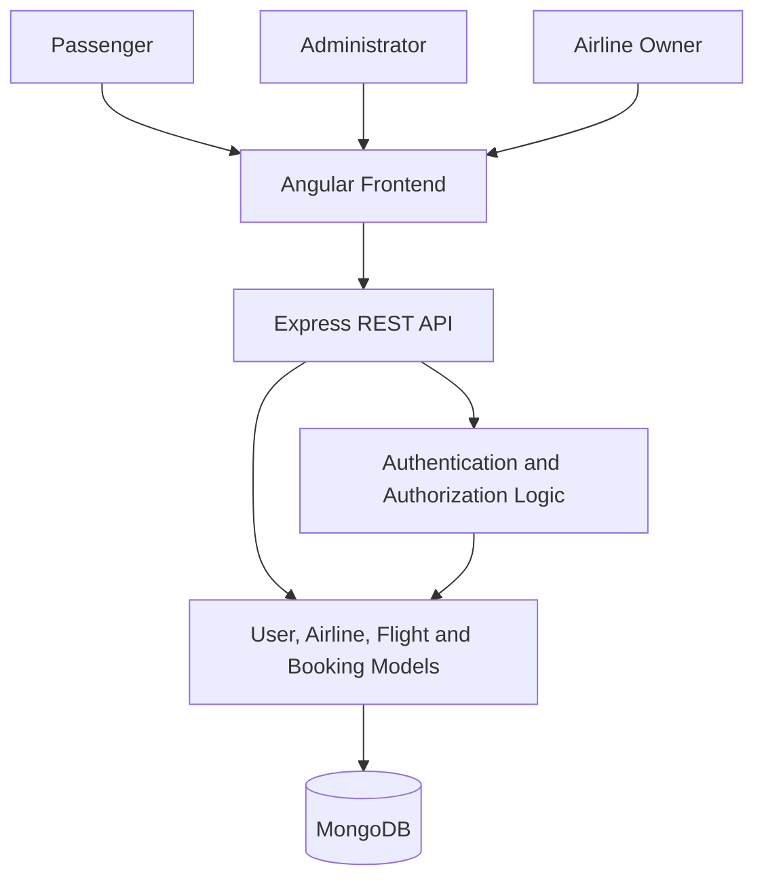

Flight Booking System
A full-stack flight booking application built with Angular, Node.js, Express, and MongoDB. The application supports passenger registration and login, flight search, seat selection, booking management, and separate interfaces for administrators and airline owners.
Features
Passenger
- Register and log in as a passenger.
- Search available flights by departure city, destination, and journey date.
- Choose one-way or round-trip travel.
- View flight details, including airline, flight number, departure and arrival times, price, and seat availability.
- Select seats and enter passenger details when booking.
- View booking information and payment status.
- Cancel eligible bookings.
Administrator
- Access a separate admin area.
- View dashboard counts for users, flights, and bookings.
- View user, flight, and booking information.
- Add flights.
Airline owner
- Register and log in through the airline-owner flow.
- View flights associated with an airline.
- Access airline booking information.
Technology Stack
Layer	Technologies
Frontend	Angular 16, TypeScript, HTML, CSS
UI and styling	Bootstrap 5, ng-bootstrap, Font Awesome
Backend	Node.js, Express.js
Database	MongoDB, Mongoose
Authentication	JSON Web Tokens (JWT), bcrypt
HTTP communication	Angular HttpClient
Reactive programming	RxJS

Application Architecture
The Angular client communicates with the Express REST API. The API uses Mongoose to read and write application data in MongoDB.

Project Structure
flight-booking-main/
├── client/
│   ├── src/
│   │   └── app/
│   │       ├── components/
│   │       │   ├── home/
│   │       │   ├── login/
│   │       │   ├── register/
│   │       │   ├── bookings/
│   │       │   ├── owner-login/
│   │       │   └── owner-regiter/
│   │       ├── modules/
│   │       │   └── admin/
│   │       └── ownermodules/
│   │           └── owner/
│   ├── angular.json
│   └── package.json
│
└── server/
    ├── src/
    │   ├── app.js
    │   ├── db/
    │   │   └── connect.js
    │   └── models/
    │       └── schema.js
    └── package.json
Prerequisites
Install the following before running the application:
- Node.js and npm
- MongoDB database (local MongoDB or MongoDB Atlas)
- Git
Getting Started
1. Clone the repository
git clone https://github.com/LeelaVani238/flight-booking-main.git
cd flight-booking-main
2. Configure the database
The backend connects to MongoDB from server/src/db/connect.js.

Configure your own MongoDB connection string there before starting the backend. Keep database credentials private and do not commit connection strings or other secrets to GitHub.

For a production-ready setup, move the connection string and JWT signing secrets into environment variables and load them in the backend rather than hardcoding them in source files.
3. Install backend dependencies
cd server
npm install
4. Start the backend
npm run dev
The Express server uses port 5100 by default.
5. Install frontend dependencies
Open a second terminal:
cd flight-booking-main/client
npm install
6. Start the Angular application
npm start
Angular's development server normally runs at:
http://localhost:4200
The frontend currently makes API requests to:
http://localhost:5100
Keep the backend running while using the frontend.
API Overview
The backend defines the following main routes:
Method	Endpoint	Purpose
POST	/register	Register a user
POST	/login	Log in a user
POST	/airline-register	Register an airline
POST	/airline-login	Log in an airline owner
GET	/users	Retrieve users
GET	/flights	Retrieve all flights
GET	/flights/:id	Retrieve a flight by ID
GET	/flights/airline/:airline	Retrieve flights for an airline
POST	/flights	Create a flight
POST	/bookings	Create a booking
GET	/bookings	Retrieve bookings
GET	/bookings/user/:userId	Retrieve bookings for a user
GET	/bookings/flight/:flightId	Retrieve a booking for a flight
DELETE	/bookings/:id	Cancel/delete a booking
POST	/bookings/:id/payments	Update booking payment status

Database Models
The application uses Mongoose models for:
- User: passenger/admin/owner account details and hashed password.
- Airline: airline account details and hashed password.
- Flight: airline, flight number, route, schedule, price, and seat information.
- Booking: user, flight, passenger names, journey details, selected seats, fare, and payment information.
Notes
- The project is structured as separate Angular frontend and Express backend applications; install dependencies in both folders.
- The backend currently uses a MongoDB connection string defined in its source file. Replace it with your own private database configuration before running the project.
- The frontend currently references the local backend URL (http://localhost:5100). Update the API base URL if you deploy the backend elsewhere.
- The payment route in the current backend updates a booking's payment status; this repository does not show an integration with an external payment gateway.
- Before deploying publicly, review authentication and authorization, protect administrative and airline-owner routes on the server, use environment variables for secrets, and validate booking and seat availability on the backend.
Future Improvements
- Add a secure environment-based configuration for database credentials and JWT secrets.
- Add server-side role and token verification middleware for protected endpoints.
- Add transactional or atomic seat reservation checks to prevent duplicate seat bookings.
- Integrate a payment gateway for real payment processing.
- Add automated backend tests and API documentation.
- Configure a production deployment and frontend environment-specific API URL.
License
No project-specific license is currently declared in the backend package configuration. Add a LICENSE file if you intend to distribute this project under an open-source license.
