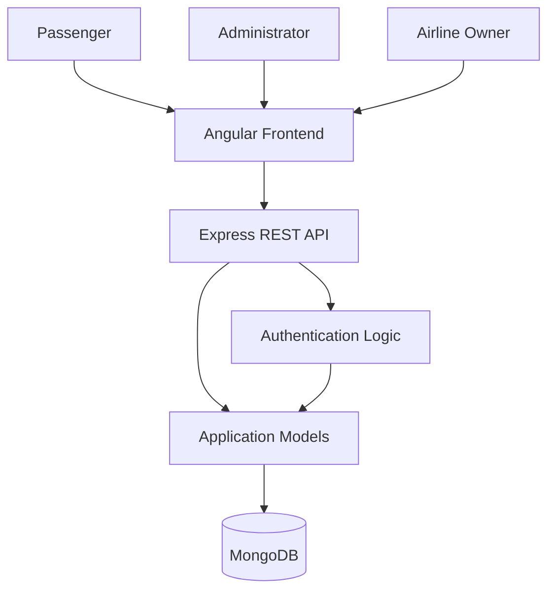

# Flight Booking System

A full-stack flight booking application built using Angular, Node.js, Express.js, and MongoDB. The application provides separate interfaces for passengers, administrators, and airline owners to manage flight searches, seat selection, bookings, and flight information.

## Features

### Passenger
- User registration and login.
- Search flights by departure city, destination, and journey date.
- Choose one-way or round-trip journeys.
- View flight details, schedules, prices, and seat availability.
- Select seats and enter passenger details.
- View booking information and payment status.
- Cancel eligible bookings.

### Administrator
- Separate admin interface.
- Dashboard with user, flight, and booking information.
- View registered users.
- View and manage flight information.
- Add new flights.

### Airline Owner
- Airline owner registration and login.
- View flights associated with an airline.
- Access airline booking information.

## Technology Stack

| Layer | Technologies |
|---|---|
| Frontend | Angular 16, TypeScript, HTML, CSS |
| UI Framework | Bootstrap 5, ng-bootstrap |
| Backend | Node.js, Express.js |
| Database | MongoDB, Mongoose |
| Authentication | JWT, bcrypt |
| HTTP Communication | Angular HttpClient |
| Reactive Programming | RxJS |

## System Architecture

The application follows a client-server architecture. The Angular frontend communicates with the Express REST API, which handles authentication, application logic, and database operations through Mongoose.



## Project Structure

```text
flight-booking-main/
│
├── client/
│   ├── src/
│   │   └── app/
│   │       ├── components/
│   │       │   ├── home/
│   │       │   ├── login/
│   │       │   ├── register/
│   │       │   ├── bookings/
│   │       │   ├── owner-login/
│   │       │   └── owner-regiter/
│   │       ├── modules/
│   │       │   └── admin/
│   │       └── ownermodules/
│   │           └── owner/
│   ├── angular.json
│   └── package.json
│
└── server/
    ├── src/
    │   ├── app.js
    │   ├── db/
    │   │   └── connect.js
    │   └── models/
    │       └── schema.js
    └── package.json
```

## Installation and Setup

### Prerequisites

- Node.js
- npm
- MongoDB
- Git

### 1. Clone the Repository

```bash
git clone https://github.com/LeelaVani238/flight-booking-main.git
cd flight-booking-main
```

### 2. Configure MongoDB

Configure your MongoDB connection string in:

```text
server/src/db/connect.js
```

Use your own database credentials and keep sensitive information out of the repository.

### 3. Install Backend Dependencies

```bash
cd server
npm install
```

### 4. Start the Backend Server

```bash
npm run dev
```

The backend runs on:

```text
http://localhost:5100
```

### 5. Install Frontend Dependencies

Open another terminal:

```bash
cd flight-booking-main/client
npm install
```

### 6. Start the Angular Application

```bash
npm start
```

The frontend runs on:

```text
http://localhost:4200
```

Make sure both frontend and backend servers are running.

## API Endpoints

| Method | Endpoint | Description |
|---|---|---|
| POST | /register | Register a user |
| POST | /login | User login |
| POST | /airline-register | Register an airline |
| POST | /airline-login | Airline owner login |
| GET | /users | Retrieve users |
| GET | /flights | Retrieve all flights |
| GET | /flights/:id | Retrieve flight details |
| GET | /flights/airline/:airline | Retrieve airline flights |
| POST | /flights | Create a flight |
| POST | /bookings | Create a booking |
| GET | /bookings | Retrieve bookings |
| GET | /bookings/user/:userId | Retrieve user bookings |
| GET | /bookings/flight/:flightId | Retrieve flight booking |
| DELETE | /bookings/:id | Cancel/delete a booking |
| POST | /bookings/:id/payments | Update payment status |

## Database Models

The application uses MongoDB with Mongoose schemas for:

- **User:** Stores passenger, administrator, and account information.
- **Airline:** Stores airline owner account information.
- **Flight:** Stores airline details, flight number, routes, schedules, prices, and seat information.
- **Booking:** Stores passenger details, selected seats, flight information, fare, and payment status.

## Future Improvements

- Integrate a secure online payment gateway.
- Implement enhanced server-side role-based authorization.
- Improve seat availability validation and reservation handling.
- Add automated testing for APIs and application workflows.
- Introduce environment-based configuration for deployment.
- Improve booking notifications and user experience.

## License

No specific open-source license is currently included in this repository.
